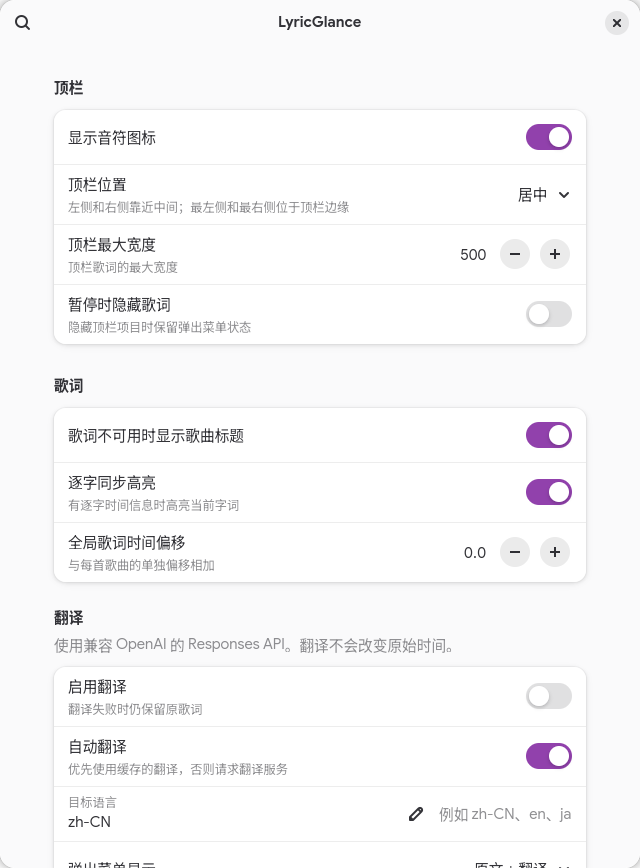

# LyricGlance

LyricGlance 在 GNOME 顶栏显示 MPRIS 播放器的同步歌词，并可在原生 Shell 弹出菜单中查看封面、
播放进度、逐行/逐字歌词和可选的行级翻译。




## 功能

- 通过 MPRIS 自动发现播放器；不依赖 `playerctl`，不轮询播放器状态。
- 从 LRCLIB 获取逐行、逐字、纯文本或纯音乐信息，可选 LrcAPI 补充同步或纯文本歌词。
- 顶栏歌词、原生 popup、封面、播放/暂停、上一首/下一首、可交互播放进度、播放器选择和每首歌曲时间偏移。
- 原文、双语或仅译文显示；原歌词和 timing 始终是唯一事实来源。
- 逐字高亮只作用于原文，不为译文伪造 karaoke timing。
- 超宽同步歌词按播放时间滚动；超宽弹窗标题往返循环，关闭系统动画时同步歌词改为分段显示。
- 无歌词时可在顶栏往返循环曲目标题；歌词库标记为纯音乐的曲目也显示标题，弹窗保留纯音乐说明。
- 有界的歌词、封面、翻译和歌曲偏移缓存。
- GTK4/Libadwaita Preferences；英文和简体中文界面。

更多发布截图见 [`docs/screenshots/`](docs/screenshots/)。

## 兼容性

- Fedora Linux
- GNOME Shell 50（已在 50.4 测试，近期滚动回归使用 50.5）
- Wayland
- GJS ES Modules

`metadata.json` 只声明 GNOME Shell 50。GNOME 49 和 51 未验证，也未声明支持。播放器只需
正确实现 MPRIS 2；不会为 Spotify 或浏览器使用专用 API。详细手工验证状态和未来升级
风险见 [`docs/compatibility.md`](docs/compatibility.md)。

## 安装

LyricGlance 使用新的 `lyric-glance@eureka` UUID、GSettings schema、gettext domain
和 XDG 数据目录。旧版设置、翻译密钥和缓存不会自动迁移；安装新版时，GNOME 可能同时
保留旧 UUID 的扩展，因此请按需从 Extensions 中禁用或移除旧版。仓库链接已改为
`eurekaevan/lyric-glance`；GitHub 远端仓库也需改用该 slug，链接才能生效。

### Release 用户

从 GitHub Release 下载 `lyric-glance@eureka.shell-extension.zip`，然后运行：

```sh
gnome-extensions install --force lyric-glance@eureka.shell-extension.zip
gnome-extensions enable lyric-glance@eureka
```

首次安装或更新 JavaScript 后请注销并重新登录。GNOME Shell 50 会在当前 Shell 进程中
缓存已导入的 ESM，单纯 disable / enable 不能证明新模块已经 fresh-import。

项目提交到 extensions.gnome.org 前不会在这里放置不存在的商店链接。

### 开发者

```sh
git clone https://github.com/eurekaevan/LyricGlance.git
cd LyricGlance
make check
make install
gnome-extensions enable lyric-glance@eureka
```

## Preferences

```sh
gnome-extensions prefs lyric-glance@eureka
```

可设置顶栏位置和宽度、暂停时可见性、逐字高亮、全局歌词时间偏移、翻译显示方式、
目标语言、翻译 API 端点和模型、播放器偏好，以及清理扩展自己的缓存。每首歌曲的单独
偏移在 popup 中调整。

设置通过 GSettings 即时生效。`preferred-player` 保存稳定的 DesktopEntry/Identity，
不保存临时 MPRIS bus name。

## 翻译设置

翻译默认关闭。Preferences 可配置完整的 OpenAI-compatible Responses API 端点、模型和
API 密钥；默认端点是 `https://api.openai.com/v1/responses`。API 密钥只写入 GNOME
Secret Service/libsecret，不进入 GSettings、JSON cache、请求日志或 Git；端点和模型
作为普通设置保存并即时生效。为避免明文泄露密钥，远程端点必须使用 HTTPS，本机
`localhost`/loopback 调试端点可使用 HTTP。

自定义端点会接收 Bearer API 密钥、歌曲标题/艺术家和待翻译歌词，请只配置可信服务。
端点必须兼容 Responses API 的 structured output 请求和响应格式；仅兼容 Chat
Completions 的服务不能直接使用。模型名称不再固定，但该模型仍须由所配置的端点支持。

翻译使用缓存优先的行级文档：每行以稳定 `lineId` 对齐，并校验原歌词 hash。请求失败时
原歌词仍可用。自动翻译也必须先显式启用翻译功能。

## 工作方式

```text
MPRIS signals
  → normalized playback state
  → LRCLIB lookup and LyricsDocument
  → monotonic playback synchronization
  → panel and popup updates
```

播放器发现使用 `NameOwnerChanged`，状态更新使用 `PropertiesChanged`，跳转使用 `Seeked`。
歌词只为下一行、下一字或分段显示边界安排一次性 timer；popup 打开时每 500 ms 从现有 monotonic
clock 刷新纯 UI 进度，关闭后立即移除，不额外读取 D-Bus Position。

popup 中的媒体按钮控制当前选中的播放器，按 MPRIS 能力禁用不支持的操作。
进度滑块支持点击、拖动和键盘左右键；拖动时预览时间，释放后提交一次 `SetPosition`。
换歌、换播放器或关闭 popup 会取消未提交的拖动；跳转携带当前曲目 ID，进度不包含歌词时间偏移。
控制失败在媒体区显示简短提示，状态和歌词同步以播放器反馈为准。没有有效时长或曲目 ID
时禁用定位；没有时长时隐藏进度条。命令完成后若尚未收到变化信号，只执行一次状态或位置校准。
popup 使用 Shell 原生滑块和主题。

是否需要校准按本次操作对应的位置或播放状态通知判断，音量、控制能力或封面通知不能代替
操作反馈；属性被声明失效后，旧反馈也不再有效。并发位置/完整状态读取只接受最新请求，
完整回读不会覆盖期间收到的较新封面或控制能力。请求失败时保留本地时钟，不增加持续轮询。

没有歌词且关闭歌曲信息回退时，顶栏仍保留媒体图标入口（即使关闭了常规图标显示）。
“暂停时隐藏”仍按已有设置生效；开启后需要从播放器恢复播放，或关闭该设置以通过 popup 恢复。

运行时资源由创建它们的 owner 释放：disable/destroy 会取消 `Gio.Cancellable`、移除 GLib
和 Meta later source、断开 signal、停止 transition、销毁 actor 并释放引用。异步结果再
通过 request generation 或当前 owner identity 防止旧请求覆盖新歌曲。

### 歌词与标题滚动

仅超出实际文字视口的同步歌词需要滚动。视口宽度来自布局分配，音乐图标及其间距不计入
可用文字宽度；窗口缩放、字体或布局变化后会重新测量。纯文本歌词仍在弹窗中查看，
不为其生成虚假的播放时间轴。

设置项 `max-panel-width` 是上限；当前控件首选宽度为 320 px，低于此值时按设置收窄。
其他顶栏控件占用空间时，实际宽度可以更小。滚动距离、逐字焦点、分页和渐隐均按实际
文字视口计算；修改宽度或图标设置后，即使受挤压而实际宽度未变，也会重新调度滚动。

确认没有歌词后，若开启“歌词不可用时显示歌曲标题”，顶栏显示曲目标题并在溢出时往返循环；
关闭该开关仍只显示图标入口。歌词库明确标记为纯音乐时，顶栏原来的 `Instrumental` 改为
曲目标题并使用相同循环，弹窗继续显示“纯音乐”。标题循环不依赖歌词时间轴，也不增加轮询。
暂停或悬停时冻结，恢复时沿当前方向继续；短标题静止，关闭系统动画时静态省略。
加载中的回退信息和只有纯文本歌词的入口保持原有行为。

逐行歌词先短暂停留行首，再线性移动，最后停留在句尾。正常移动阶段尽量在四秒内完成，
避免间奏或尾奏把滚动拉得过慢；特别长的文字会参考 240 px/s 延长移动阶段，但仍受
本行时长约束，因此这不是硬性速度上限。句尾至少预留 200 ms 阅读时间，极短行改为行长
的 25%；这些时间会按播放速率换算。正常滚动按溢出情况使用边缘渐隐；溢出超过 8 px
时增加 8 px 句尾留白，小幅溢出只移动实际溢出的距离。

暂停会冻结滚动，恢复和跳转按当前播放位置重新定位。同行重新同步会保留正在显示的文字，
不先切回行首。鼠标悬停顶栏时暂停滚动，离开后用约 200 ms 追赶当前进度再继续；
弹窗打开期间顶栏继续跟随播放。隐藏期间收到歌词时，重新显示后也会启动滚动。

开启逐字同步且原文词时间、文字和布局都适合跟随时，使用实际字形位置，让当前词经过
视口约 60% 的阅读位置。双向文字、拆分字形、重叠词时间或不匹配的文本退回逐行滚动。
译文始终使用原行时间轴，不复用原文的逐字位置。高分屏的字形测量会换算为逻辑像素。

关闭 GNOME Shell 动画后，超宽同步歌词按时间切换有重叠的文字片段，不做连续滑动；
暂停、跳转和悬停仍然生效，重新打开动画会恢复连续滚动。超宽弹窗标题在此模式下保留
静态省略显示；正常动画模式下停留行首后向左移动，在末尾停留并返回，关闭弹窗即停止循环。
短标题和放得下的歌词保持静止。

### 时间轴与结束时间

`extension.js` 为顶栏生成 `startMs`、`endMs`、`positionMs` 和 `playbackRate`。
`positionMs` 来自播放器时钟加全局及单曲偏移，与歌词时间戳使用同一坐标；媒体进度条和
`SetPosition` 使用不带歌词偏移的播放器时间。跳转、偏移及播放状态变化后重新同步。

行结束时间优先取明确的 `endMs`，否则采用末词已知结束时间，并保留更晚结束的重叠词；
末词没有结束时间时，不借用前词的结束时间。已知结束时间以次行开始时间为上限。
没有明确结束时间时用次行开始时间，最后一行再回退到带歌词偏移的曲目结尾。
普通 LRC 解析后的 `endMs` 为 `null`；不按字数猜测演唱时长，以免误判慢歌和长音。

滚动完成不会自行清空这一行；歌词选择仍由下一行时间戳决定，歌词中的空白行可表示间奏。
因此，四秒阅读窗口只影响文字如何移动，不提前切换歌词，也不改写源时间戳。
逐行和分段位置计算在 `ui-utils.js`，显示、字形测量、重排和计时器清理在 `indicator.js`，
当前行与字边界选择在 `lyrics-synchronizer.js`。

### 主要模块

- `extension.js`：扩展生命周期和 MPRIS → lyrics → UI 协调。
- `mpris.js`：D-Bus discovery、signal-driven playback clock 和 player policy。
- `lyrics.js`、`lyrics-*`：LRCLIB、解析、匹配、统一文档与同步。
- `translation-*`、`credentials.js`：独立翻译文档、provider、cache 和 Secret Service。
- `indicator.js`、`artwork-*`、`ui-utils.js`：Shell UI、封面和纯 UI 计算。
- `storage.js`：有界缓存和歌曲偏移持久化。
- `prefs.js`、`schemas/`：Preferences 和 GSettings。

## LrcAPI 备用歌词源

在设置的“歌词”中打开“使用 LrcAPI 作为备用歌词源”。默认关闭。启用后，选择顺序为
**可信的时间轴歌词 > 纯文本歌词 > 无歌词**：LRCLIB 已有逐字或逐行歌词时直接使用；
只有纯文本或没有歌词时继续查询 LrcAPI。备用源有匹配可信的同步歌词就升级显示；只有
纯文本、没有结果或查询失败时保留主源原文。主源没有原文时也可采用匹配可信的备用纯文本。
同等质量优先 LRCLIB，候选必须先通过歌名、歌手和可用时长等匹配检查。纯音乐标记仍作为
确定结果保留。主源服务错误不会触发备用查询，但已有缓存原文会保留。
本次接入 LrcAPI 的逐行及纯文本内容，不接入逐字或翻译数据。

默认地址为 `https://api.lrc.cx/jsonapi`。也可填写自建 LrcAPI 的完整 JSON 搜索接口地址，
例如 `http://127.0.0.1:28883/jsonapi` 或支持该路由的 `/api/v1/lyrics/advance`。
修改后点击输入框的应用按钮，当前歌曲会重新查询。地址必须使用 HTTPS；仅本机回环地址
允许 HTTP。不支持 URL 中携带账号、密码、查询参数或 fragment，也不跟随备用服务的重定向。
本次未提供需要鉴权的自建实例的密钥配置。

适配候选数组中的 `title`、`artist`、可选 `album`/`duration` 和 `lyrics` 或 `lrc` 字段，
使用歌名、歌手、专辑和可用时长筛选候选，而不是直接采用第一条。缺少时长时无法保证
不同录音版本完全对应，仍可能需要手动调整偏移。接口文档见
[LrcAPI 歌词 API](https://docs.lrc.cx/docs/APIv1/lyrics/)。2026-10-13 公共服务实测中，
文档里的 `/api/v1/lyrics/advance` 返回 404，`/jsonapi` 返回使用 `lrc` 字段的候选数组。

备用结果按是否启用及服务地址隔离缓存，避免启用或切换服务后复用旧的未找到结果。
成功的备用歌词会缓存并保留来源。弹窗歌词区域下方显示实际歌词来源，缓存命中时保持一致。
备用空结果、404、低可信候选和服务故障均不缓存为“没有歌词”，以后可重试。
只取得纯文本时保留原文缓存，但后续查询仍尝试获取同步歌词，避免原文缓存长期阻止升级。
只有空白的文本或只有空白行的时间轴不算可用歌词，正常歌词中的空白行仍保留。
启用备用源时也会重试旧版本留下的负缓存，避免历史空结果继续阻挡同步歌词查询。
新优先规则使用独立的缓存配置签名，旧备用缓存不会跳过本次选择流程。
成功的备用结果可替代不能显示的主源原始数据。

### 快速切歌、限流与重试

缓存命中直接使用；需要联网时，等待曲目稳定 600ms 后才查询，快速跳过的歌曲不会
排队请求。网络请求仍至少间隔 300ms。

LRCLIB 和 LrcAPI 的 HTTP 429、503 都会触发有限重试，每个查询阶段最多额外重试
4 次。有有效的 `Retry-After` 时按秒数或 HTTP 日期等待，至少等待 1 秒；缺失或无效时
依次等待 1、2、4、8 秒。服务给出的较长等待时间不会被截短为 1 秒。
冷却按服务保留，LRCLIB 的 get/search 共用冷却，LrcAPI 单独计算；切歌和清理歌词缓存
不会清除冷却。更改备用源设置重建客户端、关闭扩展或退出登录时冷却清除，不跨登录保存。

等待重试时弹窗显示“正在重试歌词…”，已有主源纯文本则继续显示，成功取得同步歌词后
替换。没有歌词可显示时，顶栏按现有设置显示歌曲信息或循环标题。歌词晚于歌曲开始返回，
仍按当前播放器时间及歌词偏移对齐，不从开头播放。

重试耗尽或遇到其他请求错误时，没有可用歌词才显示“歌词服务暂不可用”；已有纯文本
会保留。临时错误不会写入“没有歌词”的缓存，只有正常查询完成的空结果才显示
“未找到歌词”。这里只自动重试 429/503，其他 HTTP、连接或解析错误会结束本轮查询。
次数耗尽后不再后台轮询；再次选择该歌曲或重新查询时可再尝试，并继续遵守已有冷却。
切歌、播放器更换及扩展关闭会取消旧请求和重试，旧结果不能覆盖新歌。

## 开发与测试

确定性发布检查：

```sh
make clean
make check
make integration
```

`make check` 验证 schema、gettext、纯逻辑测试、打包、zip 内容和所有相对 runtime imports；
`make integration` 使用隔离 D-Bus 和本地 HTTP server 验证 MPRIS 事件、切歌防抖、429/503
冷却及有限重试、网络错误、响应大小限制、取消、缓存和存储，不访问 Spotify、LRCLIB
或真实翻译 API。

滚动涉及实际 Shell 布局和生命周期，还需使用已打包的当前代码运行隔离 Shell 回归：

```sh
make pack
cp lyric-glance@eureka.shell-extension.zip /tmp/lyric-glance@eureka.shell-extension.zip
dbus-run-session -- env XDG_RUNTIME_DIR=/tmp/lyricglance-media-runtime \
  GIO_USE_VFS=local GSETTINGS_BACKEND=memory \
  gnome-shell-test-tool --headless \
  --extension /tmp/lyric-glance@eureka.shell-extension.zip tests/shell-extension.js
```

需要本机已安装 GNOME Shell 测试工具及相关运行库。每次重建后必须覆盖 `/tmp` 中的包，
否则可能测试到旧代码。该测试覆盖结束时间选择、同行重同步、字体和视口变化、隐藏后显示、
标题循环，以及原生动画开关下的分页、暂停、悬停和跳转；它不证明当前桌面已加载新版，
也不替代真实播放器、物理鼠标操作、高分屏视觉检查和长时间日志观察。

打包：

```sh
make pack
unzip -l lyric-glance@eureka.shell-extension.zip
```

自动发布使用日期标签 `YYYY-MM-DD`，例如 `2026-10-09`。将包含发布工作流的改动提交到
要发布的 commit 后，创建并推送标签：

```sh
git tag 2026-10-09
git push origin 2026-10-09
```

请将示例日期替换为实际发布日期。Release 工作流会校验日期、执行 `make check` 和
`make integration`，通过后自动创建该日期的 GitHub Release，并上传 ZIP 和 SHA-256
校验文件。普通分支推送只上传 Actions artifact；版本号标签不再触发 Release 工作流。
同一天需要重试时，在 Actions 中重新运行该日期标签的工作流，会更新已有 Release
的附件；重跑仍使用该标签对应的 commit，不会自动包含后来提交的改动。

可选的 Secret Service 测试会写入一个独立测试 secret，并在结束前删除：

```sh
make integration-secret
```

真实播放器或网络测试位于 `tests/integration-live-*.js`。部分测试会控制播放状态或切歌，
运行前请阅读文件和命令说明。发布验证详情见 [`docs/EGO-CHECKLIST.md`](docs/EGO-CHECKLIST.md)。

## 已知限制

- 顶栏五种位置需要 GNOME Shell 50 的 `Main.panel._leftBox/_centerBox/_rightBox`；Shell 50
  没有提供等价的公开运行时移动 API。访问已集中在一个兼容函数中。
- Firefox Spotify Web 可能复用 TrackId，因此歌曲 identity 同时包含 bus、TrackId、
  title、artist 和 duration。
- LRCLIB 或翻译服务不可用时会优雅 fallback，但无法提供未缓存的新内容。
- 新 JavaScript 在当前 GNOME Shell 50 会话中需要注销/登录后才能得到 fresh ESM 证明。

## 隐私与网络访问

扩展读取当前 MPRIS 播放器公开的：

- title、artist、album；
- playback status、position、duration；
- `mpris:artUrl`。

可能产生的外部访问：

- **LRCLIB**：发送当前歌曲的 title、artist、album 和 duration，以查找歌词。
- **LrcAPI（仅启用备用源时）**：主源没有同步歌词后，将 title、artist、album 发送到配置的服务；公共服务可能继续查询其上游来源。
- **已配置的翻译 provider**：仅在翻译已启用并实际请求时发送 title、artist、歌词文本和
  target language。
- **Artwork**：读取播放器提供的本地 `file://`，或仅在播放器给出远程 art URL 时访问
  HTTP(S) 地址。

扩展不读取 Spotify account token，不使用 Spotify OAuth，不读取浏览器 cookie，不扫描
浏览器或 Spotify 文件系统，不上传播放历史。AI 翻译默认关闭。网络响应有大小上限，
请求可取消；429 最多重试一次并尊重 `Retry-After`。Authorization header 和 API key
不会写入 journal。

持久数据只写入扩展自己的 namespace：

- `$XDG_CACHE_HOME/lyric-glance/`：歌词、封面和翻译 cache；
- `$XDG_CONFIG_HOME/lyric-glance/offsets.json`：每首歌曲的歌词偏移；
- GNOME Secret Service：翻译 credential。

清理按钮只删除对应的扩展 cache，不删除父目录或其他应用数据；disable 不删除持久状态。

## License

LyricGlance 采用 [GPL-2.0-or-later](LICENSE)。随包提供的 readable ESM
`js-yaml` 4.1.0 采用 MIT License；来源、固定 SHA-256、是否修改和复现方式见
[`README.js-yaml.md`](README.js-yaml.md) 与 [`LICENSE.js-yaml`](LICENSE.js-yaml)。
