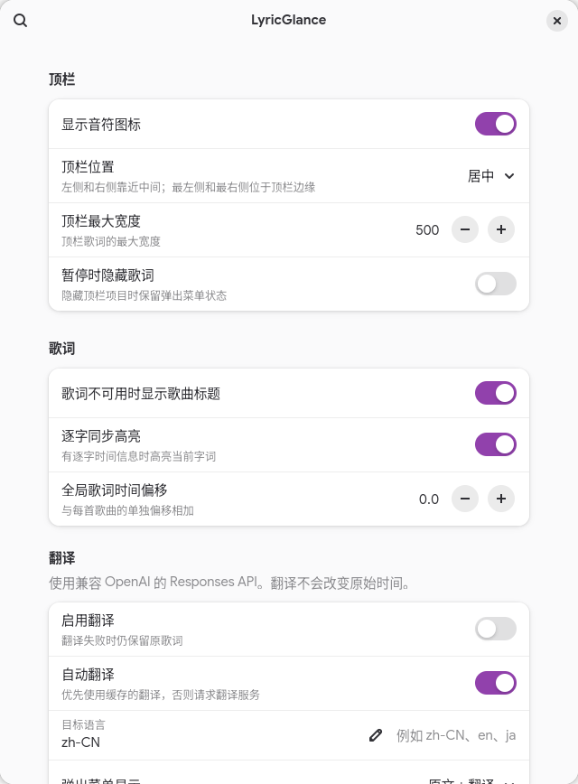

# LyricGlance

English · [简体中文](README.zh-CN.md)


Icons: [Color SVG](icon.svg) · [512px PNG](icon.png) · [Top-bar Symbolic SVG](icons/lyric-glance-symbolic.svg)

LyricGlance displays synchronized lyrics for MPRIS-compatible media players in the GNOME top bar,
with a native Shell popup featuring album artwork, interactive playback controls, line/word-level
lyrics, and optional line-level translation.




## Features

- Automatic MPRIS 2 player discovery with event-driven synchronization (no `playerctl`, no position polling).
- Line-synced, word-synced, plain-text, and instrumental lyrics from LRCLIB, with optional LrcAPI fallback.
- Top-bar lyrics and native popup with album artwork, play/pause, previous/next, interactive seek slider, player selection, and per-track timing offset.
- Original, bilingual, or translation-only popup display; original lyrics and timestamps always remain the single source of truth.
- Word-level karaoke highlighting applies to original lyrics only and never fabricates timing for translations.
- Playback-timed scrolling for overflowing panel lyrics, seamless looping for overflowing titles, and timed paged display when animations are disabled or reduced motion is enabled.
- Optional looping track title in the top bar when no lyrics exist or a track is marked instrumental (while keeping the instrumental indicator in the popup).
- Bounded local caches for lyrics, artwork, translations, and per-track offsets.
- GTK4/Libadwaita Preferences with English, Simplified Chinese (`zh_CN`), and Traditional Chinese (`zh_TW`) translations.

More screenshots are available in [`docs/screenshots/`](docs/screenshots/).

## Compatibility

- Fedora Linux
- GNOME Shell 50 / 51 (historical Shell 50 verification across 50.4-50.6; Shell 51 verified on 51.1)
- Wayland
- GJS ES Modules

`metadata.json` declares GNOME Shell 50 and 51; GNOME 49 is neither tested nor declared. Any media
player that implements MPRIS 2 works without player-specific APIs. See
[`docs/compatibility.md`](docs/compatibility.md) for the recorded verification matrix and upgrade notes.

## Installation

LyricGlance uses the `lyric-glance@eureka` UUID, GSettings schema, gettext domain, and XDG
cache/config directories. Older settings, translation keys, and caches from previous identities are
not migrated automatically; disable or remove any older UUID from Extensions if installed.

### Release Users

Download `lyric-glance@eureka.shell-extension.zip` from GitHub Releases and run:

```sh
gnome-extensions install --force lyric-glance@eureka.shell-extension.zip
gnome-extensions enable lyric-glance@eureka
```

Log out and back in after a first install or any JavaScript update. GNOME Shell 50/51 caches
imported ES modules for the lifetime of the Shell process, so disabling and re-enabling does not
reload updated modules.

### From Source

See [`docs/development.md`](docs/development.md) for build dependencies, `shexli` setup, `make check`,
and local installation steps.

## Preferences

```sh
gnome-extensions prefs lyric-glance@eureka
```

Configure top-bar position and maximum width (`max-panel-width`, 150-1000 px, default 500 px),
hide-when-paused, track-title fallback, word highlighting, global lyrics offset, LrcAPI fallback,
translation display mode, target language, translation providers/models, preferred player
(stored by stable DesktopEntry/Identity rather than temporary D-Bus names), and cache clearing.
Per-track timing offsets are adjusted directly in the popup.

## Interface Languages

The Shell popup and Preferences support English, Simplified Chinese (`zh_CN`), and Traditional
Chinese (`zh_TW`), following your GNOME session locale automatically and falling back to English
when no catalog matches. Changing the interface language does not alter track metadata, original
lyrics, or your chosen lyrics translation target language.

## Lyrics Translation

Translation is disabled by default. The **Translation** page in Preferences lets you configure
multiple custom OpenAI-compatible model providers (supporting both **Responses** and **Chat
Completions**) and switch between active providers and enabled models:

- **Endpoint & protocol**: Enter either a full endpoint or a `/v1` base URL (trailing slash
  optional). The default entry is `OpenAI` (`https://api.openai.com/v1/responses`). Base URLs append
  `/responses` or `/chat/completions` according to the selected protocol while preserving proxy
  paths; **Auto-detect from address** detects `/chat/completions` and defaults to Responses.
- **Models**: Add/remove models manually or click **Fetch models** to query `GET .../models` with
  the provider's saved API key (HTTPS or loopback HTTP only, no redirects) and pick models in a
  searchable dialog while retaining custom entries.
- **Credentials**: Each provider's API key is stored separately in GNOME Secret Service (`libsecret`)
  and never written to GSettings, JSON caches, logs, or Git. Deleting a provider removes its saved
  key; leaving the key field blank when reopening the credential dialog keeps the existing key.
  Remote endpoints require HTTPS; plain HTTP is restricted to `localhost`/loopback debugging.
- **Same-language skip**: Lyrics whose language already matches the target language are skipped
  automatically using explicit language tags or the bundled offline `franc-min` detector (no
  network requests). When skipped, the popup offers a manual **Translate anyway** button.
- **Connection check**: Click **Check connection** in Preferences to verify the entered endpoint,
  protocol, model, and saved key with a small synthetic `Hello` request (without enabling
  translation, sending track data, or writing to the translation cache; may incur minimal API cost).

Custom endpoints receive your Bearer API key, track title/artist, and lyric text — configure only
trusted providers. See [`docs/development.md`](docs/development.md#translation-internals-and-configuration)
for coalescing, mixed-language validation, batching, configuration schema details, and the
[diagnostic reason table](docs/development.md#translation-diagnostics).

## LrcAPI Fallback Lyrics Source

Enable **Use LrcAPI as fallback lyrics source** under **Lyrics** in Preferences (disabled by
default). Selection priority is **credible synchronized lyrics > plain lyrics > no lyrics**:
LRCLIB synchronized or instrumental results are used directly; LrcAPI is queried only when LRCLIB
returns plain text or no lyrics.

The default endpoint is `https://api.lrc.cx/jsonapi`, or you can enter a self-hosted JSON search
endpoint (HTTPS required; HTTP allowed only for loopback addresses, with no userinfo, query,
fragment, or redirects). See [`docs/development.md`](docs/development.md#lrcapi-fallback-rate-limiting-and-retries)
for candidate matching, caching, and rate-limit retry behavior.

## Known Limitations

- Supporting all five top-bar positions requires reading GNOME Shell 50/51's internal
  `Main.panel._leftBox`, `_centerBox`, and `_rightBox` (centralized in `extension.js`), as no
  equivalent public move API exists in Shell 50/51.
- Firefox Spotify Web can reuse MPRIS `TrackId` values, so track identity combines bus name,
  `TrackId`, title, artist, and duration.
- When LRCLIB or a translation provider is unavailable, LyricGlance degrades gracefully but cannot
  fetch uncached content.
- Updated JavaScript modules require logging out and back in for a fresh ESM import on GNOME Shell
  50/51.

## Privacy & Network Access

LyricGlance reads only the metadata exposed by the active MPRIS player:

- Track title, artist, and album
- Playback status, position, and duration
- `mpris:artUrl`

External network requests occur only as follows:

- **LRCLIB**: Sends track title, artist, album, and duration to fetch lyrics.
- **LrcAPI (only when enabled)**: Sends title, artist, and album when LRCLIB has no synchronized
  lyrics; public LrcAPI instances may query upstream services.
- **Configured translation provider**: Sends title, artist, lyric text, and target language only
  when translation is enabled and requested. Manual **Check connection** sends only the fixed
  `Hello` test string (never track metadata or lyrics).
- **Artwork**: Reads local `file://` paths or fetches HTTPS (and loopback-only HTTP) URLs with at
  most 3 safe redirects (no HTTPS downgrade or private/loopback redirects) and raster image MIME
  validation.

LyricGlance does not read Spotify tokens, use Spotify OAuth, read browser cookies, scan browser or
player filesystems, or upload listening history. AI translation is disabled by default. Network
responses are size-bounded and cancellable, retries respect `Retry-After`, and Authorization
headers / API keys are never logged. Expected upstream failures emit debug diagnostics
(`G_MESSAGES_DEBUG=Gjs-Console`) rather than recurring warnings.

Persistent data stays inside the extension's own namespaces:

- `$XDG_CACHE_HOME/lyric-glance/`: Lyrics, artwork, and translation caches
- `$XDG_CONFIG_HOME/lyric-glance/offsets.json`: Per-track lyrics timing offsets
- GNOME Secret Service: Per-provider translation API keys

Cache-clear actions remove only the corresponding extension cache (never parent or unrelated
directories), and disabling the extension does not delete saved state. Clearing the lyrics cache
cancels pending lookups and reloads the current track once cleared.

## Development

Architecture, translation internals, diagnostics, localization maintenance, ESLint setup, automated
and live test suites, and release instructions live in [`docs/development.md`](docs/development.md).

- Compatibility matrix & GNOME Shell 51 notes: [`docs/compatibility.md`](docs/compatibility.md)
- Release & EGO checklist: [`docs/EGO-CHECKLIST.md`](docs/EGO-CHECKLIST.md)
- Historical EGO audit records: [`docs/EGO-AUDIT.md`](docs/EGO-AUDIT.md)

## License

LyricGlance is licensed under [GPL-2.0-or-later](LICENSE).

- Bundled readable ESM `js-yaml` 4.1.1 (MIT): see [`LICENSE.js-yaml`](LICENSE.js-yaml) and
  [`README.js-yaml.md`](README.js-yaml.md).
- Bundled readable ESM `franc-min` 6.2.0 and dependencies (MIT): see [`LICENSE.franc`](LICENSE.franc)
  and [`README.franc.md`](README.franc.md).

Release ZIP packages include runtime code and complete license files; dependency provenance READMEs
and reproduction scripts stay in the source repository for review and verification.
