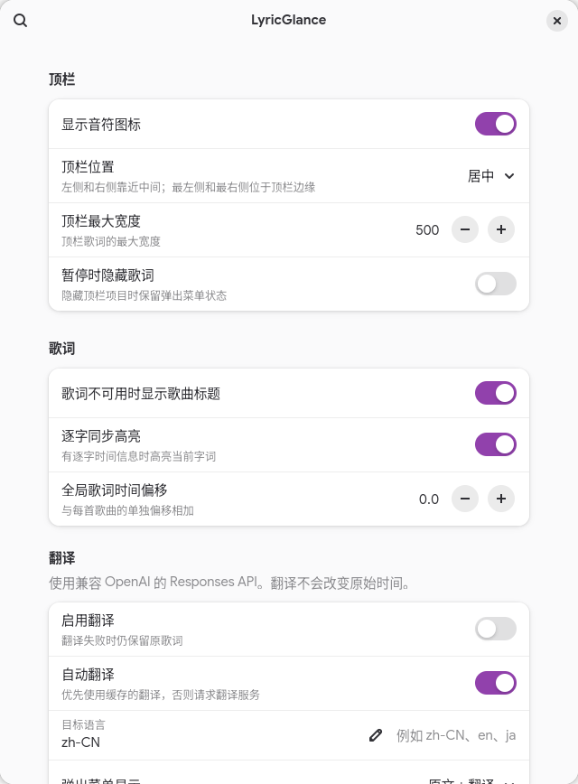

# LyricGlance

[English](README.md) · 简体中文


图标：[彩色 SVG](icon.svg) · [512px PNG](icon.png) · [顶栏单色 SVG](icons/lyric-glance-symbolic.svg)

LyricGlance 在 GNOME 顶栏显示 MPRIS 播放器的同步歌词，并可在原生 Shell 弹出菜单中查看封面、
播放进度、逐行/逐字歌词和可选的行级翻译。




## 功能

- 通过 MPRIS 2 自动发现播放器；不依赖 `playerctl`，不轮询播放器状态。
- 从 LRCLIB 获取逐行、逐字、纯文本或纯音乐信息，可选 LrcAPI 补充同步或纯文本歌词。
- 顶栏歌词、原生 popup、封面、播放/暂停、上一首/下一首、可交互播放进度、播放器选择和每首歌曲时间偏移。
- 原文、双语或仅译文显示；原歌词和 timing 始终是唯一事实来源。
- 逐字高亮只作用于原文，不为译文伪造 karaoke timing。
- 超宽同步歌词按播放时间滚动；超宽标题向左无缝循环，关闭系统动画或开启减少动态效果时改为分段显示。
- 无歌词或纯音乐曲目可在顶栏向左循环曲目标题，弹窗保留纯音乐说明。
- 有界的歌词、封面、翻译和歌曲偏移缓存。
- GTK4/Libadwaita Preferences；支持英文、简体中文（`zh_CN`）和繁体中文（`zh_TW`）界面。

更多截图见 [`docs/screenshots/`](docs/screenshots/)。

## 兼容性

- Fedora Linux
- GNOME Shell 50 / 51（50 的历史验证覆盖 50.4-50.6；51 的运行验证使用 51.1）
- Wayland
- GJS ES Modules

`metadata.json` 声明 GNOME Shell 50 和 51；GNOME 49 未验证，也未声明支持。播放器只需正确实现
MPRIS 2，无需使用 Spotify 或浏览器专用 API。详细验证记录和兼容风险见
[`docs/compatibility.md`](docs/compatibility.md)。

## 安装

LyricGlance 使用 `lyric-glance@eureka` UUID、GSettings schema、gettext domain 和 XDG
数据目录。旧版标识的设置、翻译密钥和缓存不会自动迁移；如有旧 UUID 扩展，请按需在 Extensions
中禁用或移除。

### Release 用户

从 GitHub Releases 下载 `lyric-glance@eureka.shell-extension.zip`，然后运行：

```sh
gnome-extensions install --force lyric-glance@eureka.shell-extension.zip
gnome-extensions enable lyric-glance@eureka
```

首次安装或更新 JavaScript 后请注销并重新登录。GNOME Shell 50/51 会在当前 Shell 进程中缓存已导入
的 ESM，单纯 disable / enable 不会重新加载更新后的模块。

### 从源码构建

开发者环境、固定版本 `shexli` 安装、`make check` 和本地安装步骤见
[`docs/development.md`](docs/development.md)。

## 设置（Preferences）

```sh
gnome-extensions prefs lyric-glance@eureka
```

可设置顶栏位置和最大宽度（`max-panel-width`，默认 500 px，范围 150-1000 px）、暂停时隐藏、
无歌词时显示曲目标题、逐字高亮、全局歌词时间偏移、LrcAPI 备用源、翻译显示方式、目标语言、
翻译模型服务与模型、首选播放器（保存稳定的 DesktopEntry/Identity 而非临时 D-Bus 名称），以及
清理扩展缓存。每首歌曲的单独偏移直接在 popup 中调整。

## 界面语言

扩展弹窗和设置窗口支持英文、简体中文（`zh_CN`）和繁体中文（`zh_TW`），自动跟随 GNOME 会话语言
并在无匹配翻译时回退到英文。界面语言不会改变歌曲信息、原始歌词或歌词翻译的目标语言。

## 翻译设置

翻译默认关闭。设置中的“翻译”页支持保存多个自定义 OpenAI 兼容模型服务（支持 **Responses** 和
**Chat Completions**），并可在当前服务与已启用模型间切换：

- **地址与协议**：可填写完整端点或以 `/v1` 结尾的基础地址（末尾斜杠可省略），默认条目为
  `OpenAI`（`https://api.openai.com/v1/responses`）。基础地址按所选协议自动补齐 `/responses`
  或 `/chat/completions` 并保留代理路径；“根据地址自动选择”识别 `/chat/completions`，其余默认
  Responses。
- **模型列表**：支持手动增删模型，也可点击“获取模型列表”使用已保存密钥请求 `GET .../models`
  （仅限 HTTPS 或本机回环 HTTP，不跟随重定向），在搜索弹窗中勾选保留的模型，同时保留手动模型。
- **凭据安全**：各服务的 API 密钥按服务 ID 独立写入 GNOME Secret Service（`libsecret`），不进入
  GSettings、JSON 缓存、日志或 Git；删除服务时同步清除对应密钥，再次打开凭据对话框留空保存会保留
  原密钥。远程端点强制使用 HTTPS，仅本机 `localhost`/回环调试端点允许 HTTP。
- **同语言自动跳过**：原歌词与目标语言相同时自动跳过翻译（优先使用显式语言标记，否则使用内置离线
  `franc-min` 模型检测，不额外联网）；跳过时弹窗提供手动“仍然翻译”入口。
- **连通性检查**：点击“检查连通性”使用当前输入的地址、协议、模型和已保存密钥发送固定测试文本
  `Hello` 验证结构化响应（无需开启翻译，不发送当前歌曲，也不写入翻译缓存；可能产生少量 API 费用）。

自定义端点会接收 Bearer API 密钥、歌曲标题/艺术家和待翻译歌词，请仅配置可信服务。请求合并、
混合语种校验、并发分批、配置来源约定以及
[无效响应诊断说明](docs/development.md#translation-diagnostics) 见
[`docs/development.md`](docs/development.md#translation-internals-and-configuration)。

## LrcAPI 备用歌词源

在设置的“歌词”中开启“使用 LrcAPI 作为备用歌词源”（默认关闭）。选择顺序为
**可信的时间轴歌词 > 纯文本歌词 > 无歌词**：LRCLIB 已有同步歌词或纯音乐标记时直接使用；仅在主源
只有纯文本或无歌词时继续查询 LrcAPI。

默认地址为 `https://api.lrc.cx/jsonapi`，也可填写自建 JSON 搜索接口地址（须使用 HTTPS，仅本机
回环地址允许 HTTP；不支持 URL 中的账号、查询参数、fragment，也不跟随重定向）。候选匹配、缓存
隔离与限流重试规则见
[`docs/development.md`](docs/development.md#lrcapi-fallback-rate-limiting-and-retries)。

## 已知限制

- 顶栏五种位置需要读取 GNOME Shell 50/51 的内部字段 `Main.panel._leftBox` / `_centerBox` /
  `_rightBox`（已集中在 `extension.js`），这两个版本没有等价的公开运行时移动 API。
- Firefox Spotify Web 可能复用 MPRIS `TrackId`，因此曲目身份同时包含 bus name、`TrackId`、
  标题、歌手与时长。
- LRCLIB 或翻译服务不可用时会优雅降级，但无法获取未缓存的新内容。
- 更新 JavaScript 后需注销并重新登录，才能在 GNOME Shell 50/51 中确保重新导入新模块。

## 隐私与网络访问

扩展仅读取当前 MPRIS 播放器公开的：

- 歌曲标题、歌手、专辑；
- 播放状态、进度、时长；
- `mpris:artUrl`。

可能产生的外部网络访问仅限：

- **LRCLIB**：发送歌曲标题、歌手、专辑和时长以查找歌词。
- **LrcAPI（仅启用备用源时）**：主源无同步歌词时发送标题、歌手和专辑；公共服务可能继续查询上游。
- **已配置的翻译服务**：仅在启用翻译并实际请求时发送标题、歌手、歌词文本和目标语言；手动“检查
  连通性”只发送固定文本 `Hello`，不发送歌曲或歌词。
- **封面**：读取本机 `file://` 路径或请求 HTTPS（及仅限本机回环 HTTP）地址，最多 3 次安全重定向
  （禁止 HTTPS 降级和跳向内网/回环）并校验常见光栅图片 MIME 类型。

扩展不读取 Spotify token、不使用 Spotify OAuth、不读取浏览器 cookie、不扫描播放器文件系统，
也不上传播放历史。AI 翻译默认关闭。所有网络响应均有大小上限且可取消，限流重试遵守 `Retry-After`，
Authorization 头与 API 密钥不会写入日志。常见上游失败仅记录 debug 诊断
（`G_MESSAGES_DEBUG=Gjs-Console`），避免每首歌产生重复 warning。

持久数据仅写入扩展自有命名空间：

- `$XDG_CACHE_HOME/lyric-glance/`：歌词、封面和翻译缓存；
- `$XDG_CONFIG_HOME/lyric-glance/offsets.json`：每首歌曲的歌词时间偏移；
- GNOME Secret Service：按服务隔离的翻译 API 密钥。

清理按钮仅删除对应的扩展缓存，不影响父目录或其他应用数据；禁用扩展不会删除持久状态。清空歌词
缓存会取消旧查询，并在清理完成后重新加载当前曲目。

## 开发与文档

架构说明、翻译内部机制与诊断、界面翻译维护、ESLint 配置、测试体系与发布流程均位于
[`docs/development.md`](docs/development.md)。

- 兼容性矩阵与 GNOME Shell 51 说明：[`docs/compatibility.md`](docs/compatibility.md)
- 发布与 EGO 检查清单：[`docs/EGO-CHECKLIST.md`](docs/EGO-CHECKLIST.md)
- 历史 EGO 审查记录：[`docs/EGO-AUDIT.md`](docs/EGO-AUDIT.md)

## License

LyricGlance 采用 [GPL-2.0-or-later](LICENSE)。

- 随包提供的 readable ESM `js-yaml` 4.1.1（MIT License）：见 [`LICENSE.js-yaml`](LICENSE.js-yaml)
  与 [`README.js-yaml.md`](README.js-yaml.md)。
- 离线语种识别 `franc-min` 6.2.0 及其依赖（MIT License）：见 [`LICENSE.franc`](LICENSE.franc)
  与 [`README.franc.md`](README.franc.md)。

发布 ZIP 包保留运行时代码与完整 LICENSE 文件；两份依赖说明 README 和构建复现脚本仅保留在源码
仓库，供审核和复现使用。
